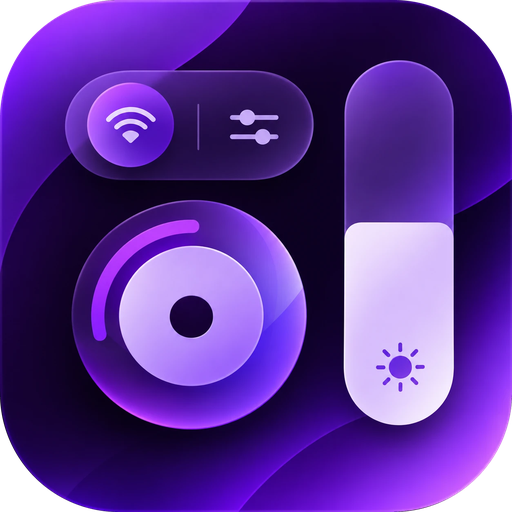
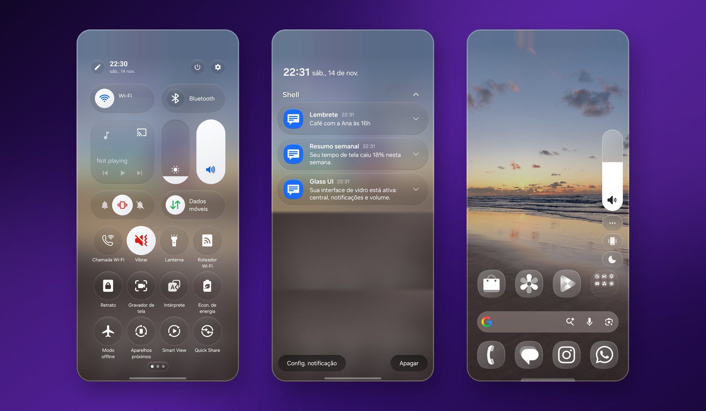
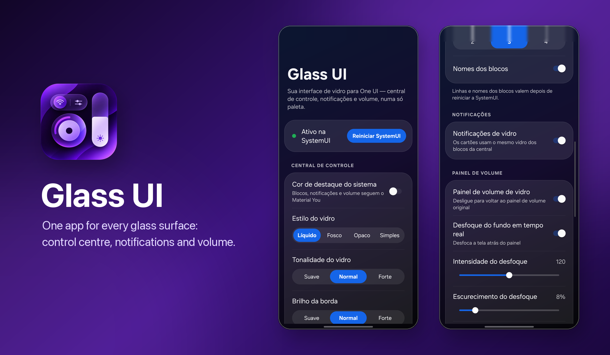

<div align="center">



# Glass UI

**A complete glass interface for Samsung One UI 9.**<br>
Control centre, notifications and volume panel — one look, one palette, one app.

[](https://github.com/AurelioMo/glass-ui/releases/latest)
[](https://github.com/LSPosed/LSPosed)
[](#requirements)

</div>

<br>



<br>

Glass UI redraws the parts of One UI you touch all day with the same liquid glass:
clear surfaces that bend the wallpaper behind them, live blur, thin bright edges and
spring motion — from the control centre and notifications to the volume panel, home-screen
widgets and folders. It runs as an LSPosed module — nothing on the system partition is
changed, and turning the module off brings stock One UI straight back.

## Highlights

<table>
<tr>
<td width="33%" valign="top">

### Control centre
- ColorOS-style cards, tall sliders and round tiles
- Liquid, Frosted, Opaque or Plain glass
- Live blur, edge shine and tilt highlights
- Per-tile accents or your Material You colour
- Move and resize everything in place

</td>
<td width="33%" valign="top">

### Notifications
- Cards in the exact glass of the control centre
- The wallpaper refracts through every card
- Clean swipe-to-dismiss — Samsung's own card blur is switched off underneath
- Same background blur as the control centre from the very first pull
- One switch to go back to stock cards

</td>
<td width="33%" valign="top">

### Volume panel
- Live-blurred glass panel with spring sliders
- White fill, dark glyphs, glass side buttons
- Ringer mode and Do Not Disturb at hand
- Blur, opacity, side and height adjustable
- Optional: volume keys always for the system

</td>
</tr>
<tr>
<td colspan="3" valign="top">

### Home screen
- Widgets in the exact glass of the control centre, over a live blur of the wallpaper — photo and gallery widgets keep their look
- Small folders, large 2×2 folders and open folders in the same glass
- Lock screen and AOD widgets are left untouched
- Separate switches for glass widgets and glass folders


### Dynamic Island
- An island around the camera for music, calls, timers, downloads and notifications, from **[Dynamic Island](https://github.com/sampple-korea/dynamicisland)**
- All of its settings live in the Glass UI app, in the same look as the rest
- Off by default — turn it on in the app

</td>
</tr>
</table>

## One app for everything



Every option lives in the Glass UI app and applies live — glass style, tint, edge shine,
blur, tile rows, tile names, notification glass, home-screen widgets and folders, and every
volume panel setting. The status
card shows whether the module is running and restarts SystemUI for you. The pencil in the
control centre is kept for what it does best: arranging your cards and tiles.

## Requirements

| | |
| --- | --- |
| **System** | Samsung One UI 9 (Android 17) |
| **Root** | Required |
| **Framework** | LSPosed with libxposed API 101 or newer |
| **Scope** | System UI · System Framework · One UI Home |
| **Tested on** | Galaxy S23 (SM-S911B) |
| **Languages** | 22 — English, Português, Español, Français, Deutsch, Italiano, Русский, Українська, Polski, Čeština, Nederlands, Svenska, Türkçe, Indonesia, العربية, हिन्दी, 日本語, 한국어, 简体中文, 繁體中文, Tiếng Việt, ไทย |

## Install

1. Download `GlassUI-*.apk` from the **[latest release](https://github.com/AurelioMo/glass-ui/releases/latest)** and install it.
2. In LSPosed, enable **Glass UI** for **System UI**, **System Framework** and **One UI Home**.
3. Reboot once.
4. Open Glass UI — the status card should read **Active in SystemUI**.

Pull down on the **left half** of the status bar for notifications and on the **right half**
for the control centre.

## Updates

Glass UI checks this repository for new releases whenever you open it, and you can check
manually under **About → Updates**. Updates are downloaded straight from GitHub and are
only installed after the SHA-256, the package name and the signing key all match. With
root the update installs silently; without it, Android's installer asks for confirmation.
Restart SystemUI afterwards to load the new module code.

## FAQ

<details>
<summary><b>The app says "Waiting for SystemUI"</b></summary>

Check that the scopes (System UI and System Framework) are enabled in LSPosed and reboot.
After updates, restarting SystemUI from the app is enough.
</details>

<details>
<summary><b>Widgets or folders are not glass</b></summary>

Enable **One UI Home** in Glass UI's LSPosed scope, then switch **Glass widgets** or
**Glass folders** off and on in the app — it restarts the home screen for you.
</details>

<details>
<summary><b>The control centre disappeared</b></summary>

Glass UI switches its control centre off after three SystemUI crashes caused by it and
keeps the stock panel. Remove the cause (usually another module hooking the same panel),
then re-enable it as root and restart SystemUI:

```sh
su -c rm /data/user_de/0/com.android.systemui/files/glassui_crashes
```
</details>

<details>
<summary><b>I see two volume panels or two control centres</b></summary>

Another module is still active. Disable other module that
replaces the same panel.
</details>

<details>
<summary><b>Reporting a bug</b></summary>

Open an issue with the Glass UI version, your device, One UI and LSPosed versions, and a
short log: `adb logcat | grep -E "LSPosed"`. Please don't post
screenshots with personal notifications, accounts or serial numbers.
</details>

## Thanks

- **jfo5** (Discord) — bug hunting and testing. Many of the fixes in Glass UI came from their reports.
- **[sampple-korea](https://github.com/sampple-korea)** — [Dynamic Island](https://github.com/sampple-korea/dynamicisland) (MIT License, © 2026 sampple-korea), included in Glass UI.

<br>

<div align="center">

Made by **[Aurélio](https://github.com/AurelioMo)**

</div>
